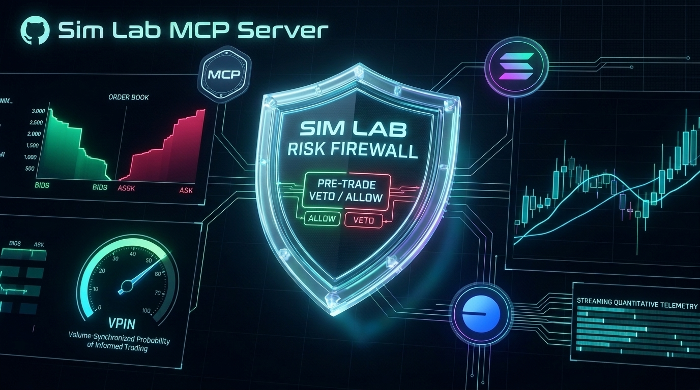

# Sim Lab — Perpetual Futures Intelligence & Pre-Trade Risk Veto (MCP Server)

<p align="center">
  
</p>

<p align="center">
  <a href="https://modelcontextprotocol.io"></a>
  <a href="https://www.x402.org"></a>
  <a href="https://base.org"></a>
  <a href="https://github.com/Measmonysuon/simlab-mcp-for-trading-agents/blob/main/LICENSE"></a>
  <a href="https://t.me/measmonysuon"></a>
</p>

---

## ⚡ Executive Overview

> **"Price feeds tell your AI agent what happened. Sim Lab tells it whether it is allowed to act."**

**Sim Lab** is a high-frequency quantitative intelligence layer and pre-trade risk firewall distilled from a live production fleet of autonomous perpetual-futures trading agents. Operating as a standard **Model Context Protocol (MCP)** server over Server-Sent Events (SSE), Sim Lab plugs directly into **Claude Desktop, ChatGPT, Cursor IDE, Windsurf, LangChain**, or any custom Python/Rust autonomous agent framework.

Before your agent places a perpetual order on any decentralized or centralized exchange (Decibel DEX, Hyperliquid, Binance, etc.), it queries Sim Lab's **4-tier risk firewall**:

1. **Market Regime Gate & Macro Freeze** — Is the broader market tradable right now? Automatically stands down agents during high-impact macro releases (CPI, FOMC, PPI) or anomalous market turbulence.
2. **Pair Directives & Toxic Quarantine** — Instantly vetoes pairs and directional biases proven toxic by fleet historical telemetry.
3. **Microstructure Liquidity Trap Shield** — Evaluates Volume-Synchronized Probability of Toxicity (VPIN), Level-2 order book depth spoofing, and Cumulative Volume Delta (CVD) flow divergence on the exact planned entry.
4. **Pre-Trade Check (`pre_trade_check`)** — A single, low-latency ($0.15) call that synthesizes all layers into a definitive `ALLOW` or `VETO` verdict.

---

## 🏛️ System Architecture & Risk Firewall

<p align="center">
  
</p>

Sim Lab sits directly between your autonomous agent's decision loop and the execution venue:

```
[ AI Trading Agent ] (Claude / GPT / Cursor / Python)
        │
        ▼ (MCP over SSE / JSON-RPC 2.0)
┌─────────────────────────────────────────────────────────────┐
│              SIM LAB PRE-TRADE RISK FIREWALL                │
├─────────────────────────────────────────────────────────────┤
│  Layer 1: Market Regime Gate & Macro Calendar Lockout       │
│  Layer 2: Pair Directives & Historical Loss Quarantine      │
│  Layer 3: Liquidity Trap Shield (VPIN, L2 Spoof, CVD Flow)  │
│  Layer 4: Pre-Trade Verdict Switch (ALLOW / VETO)           │
└──────────────────────────────┬──────────────────────────────┘
                               │
                ┌──────────────┴──────────────┐
                ▼                             ▼
       [ ALLOW / PASS ]              [ VETO / BLOCK ]
                │                             │
    Executes safely on venue        Execution aborted cleanly
    (Decibel DEX / Hyperliquid)     Zero capital risked
```

### The 4 Protective Layers

* **Layer 1: Market Regime Gate & Macro Freeze**  
  Monitors global market conditions, trend integrity, and macroeconomic news calendars. Prevents agents from entering positions minutes before violent whipsaws caused by FOMC rate decisions, CPI prints, or sudden exchange de-pegs.
* **Layer 2: Pair Directives & Quarantine**  
  Maintains rolling 30-day Walk-Forward Efficiency (WFE) metrics across 50+ perpetual pairs. Pairs suffering anomalous regime slippage or low liquidity are quarantined with mandatory directional restrictions (`LONG_ONLY`, `SHORT_ONLY`, or `BANNED`).
* **Layer 3: Liquidity Trap Shield**  
  Scans live microstructure for predatory order book traps:
  * **VPIN Toxicity** — Measures order flow toxicity to detect aggressive institutional toxicity before price flushes.
  * **L2 Order Book Imbalance** — Detects resting fake ask/bid walls meant to induce false breakouts.
  * **CVD Divergence** — Identifies aggressive market buying into resting sell liquidity (exhaustion traps).
* **Layer 4: Deterministic Pre-Trade Check (`pre_trade_check`)**  
  Combines all 3 layers into a sub-second, authoritative decision. Returns `ALLOW` with confidence telemetry and dynamic stop targets, or `VETO` with the explicit causal reason.

---

## 📊 Live Fleet Record & Quantitative Telemetry

<p align="center">
  
</p>

Sim Lab intelligence is not backtested theory — it is generated continuously by our production trading fleet on Aptos & Arbitrum perpetual DEXs:

| Metric | Verified Production Record |
|---|---|
| **Champion Strategy** | `Robust Island SMA Retest & 30% Dynamic Harvest Champion V3` |
| **Total Closed Trades** | **442** closed on-chain trades |
| **Win Rate** | **65.3%** |
| **Profit Factor** | **3.71** |
| **Net ROI** | **+68.4%** |
| **Audit Verification** | Live discovery proof block at `GET https://simlab.measmony.me/x402/info` |

### Champion Strategy: Dynamic Amber Band Harvest Mechanics
The champion strategy replaces rigid static Take Profit targets with **Amber Band gap harvesting**:
* **Tier 1 (30% Dynamic Gap Scale-Out)**: When price expands $\ge +0.50\%$ and pulls back into the 30% gap between Fast and Slow SMAs ($\lambda_{30} = 0.30$), the agent banks 30% profit and ratchets Stop Loss to Breakeven (+0.30% fee cover cushion).
* **Tier 2 (50% Midpoint Touch Exit)**: If the remaining 70% runner touches the 50% midpoint gap ($\lambda_{50} = 0.50$), the agent closes 100% of the position (`DYNAMIC_ISLAND_50%_TOUCH`), locking full campaign profits.

---

## 🔌 Connection & Setup

### MCP Server Endpoint (SSE Transport)
```
https://simlab.measmony.me/mcp/sse
```

### 1. Claude Desktop Configuration
Add Sim Lab to your `claude_desktop_config.json`:

```json
{
  "mcpServers": {
    "simlab-alpha-intelligence": {
      "url": "https://simlab.measmony.me/mcp/sse",
      "headers": {
        "x-client-id": "my-claude-agent",
        "x-wallet": "0xYourBaseWalletAddress",
        "x-spend-key": "sk_spend_YourSecretSpendKey"
      }
    }
  }
}
```

### 2. Cursor IDE / Windsurf Configuration
Add to `.cursor/mcp.json` or global MCP settings:

```json
{
  "mcpServers": {
    "simlab": {
      "url": "https://simlab.measmony.me/mcp/sse",
      "headers": {
        "x-client-id": "cursor-quant-assistant",
        "x-wallet": "0xYourBaseWalletAddress",
        "x-spend-key": "sk_spend_YourSecretSpendKey"
      }
    }
  }
}
```

### 3. Authentication & Identity
* **`x-client-id`** *(required)*: A stable, unguessable identifier for your agent (e.g. UUID v4). Credit balances are bound to this ID + wallet combination.
* **`x-wallet`** *(required)*: Your EVM wallet address on the **Base** blockchain.
* **`x-spend-key`** *(required for paid tools)*: A secret authorization token returned once upon successful on-chain settlement (`POST /x402/topup`). Stored as a cryptographic SHA-256 hash on the server, it prevents anyone who learns your client-id and wallet pair from spending your prepaid balance. Can be rotated or recovered at any time via `POST /x402/spend-key/rotate` by signing an EIP-191 message with your wallet.
* **Session Authorization**: The server enforces session-binding. Any `POST /mcp/messages` request must present matching `x-client-id`, `x-wallet`, and `x-spend-key` headers bound when the session opened, preventing session URL spend hijacking.
* **Fleet License Holders**: Institutional users can pass `Authorization: Bearer <license-key>` instead of per-call micro-billing. Request access via [alpha@measmony.me](mailto:alpha@measmony.me) or Telegram [@measmonysuon](https://t.me/measmonysuon).

> **Full Agent Walkthrough**: Need to create wallets, configure automated top-ups, and run 24/7 trading loops? Follow the step-by-step guide in [AGENT_SETUP.md](AGENT_SETUP.md). Machine-readable LLM routing is available in [llms.txt](llms.txt).

---

## 🛠️ Complete MCP Tool Catalog & Pricing

Sim Lab uses **x402 Pay-Per-Call** micro-billing in **USDC on Base**. The market regime headline is completely free; actionable intelligence tools are billed per call with zero monthly commitments. **Credits never expire, and failed calls are never charged.**

| Tool | Price (USDC) | Purpose & Decision Output |
|---|---|---|
| `get_market_regime` | **Headline: FREE**<br>Full: $0.02 | Global market condition, trend direction, volatility tier, active macro event freezes, and confidence gate. |
| `pre_trade_check` | **$0.15** | **The Master Gate**: Synthesizes regime, toxic quarantine, and trap shield into a single `ALLOW` or `VETO` verdict for a planned entry. |
| `evaluate_trap_shield` | **$0.10** | Evaluates VPIN order flow toxicity, bid-ask depth imbalance, and CVD divergence for a specific symbol and entry price. |
| `get_alpha_bundle` | **$0.15** | Downloads the complete alpha intelligence package (regime, all pair directives, top picks, and macro calendar) in one call. |
| `check_pair_directive` | **$0.05** | Checks whether a specific symbol is tradable, quarantined, or restricted to a specific direction (`LONG_ONLY`, `SHORT_ONLY`, `BANNED`). |
| `get_top_picks` | **$0.05** | Returns ranked candidate pairs clearing the dynamic quantitative score gate with entry biases and parameters. |
| `get_harvest_targets` | **$0.05** | Returns dynamic Amber Band gap targets, staged scale-out levels, and invalidation stops for a given symbol. |
| `get_robust_island_status` | **$0.05** | Evaluates whether a symbol is exhibiting the fleet champion's fast/slow SMA trend retest pattern. |
| `get_market_microstructure` | **$0.05** | Raw order flow analytics: spread, bid/ask depth wall sizes, CVD flow, VPIN score, and liquidation density clusters. |
| `get_active_strategy` | **$0.05** | Returns the active champion strategy parameters, layer configs, and live verified performance statistics. |

*Live pricing and contract parameters are published at `GET https://simlab.measmony.me/x402/info`.*

---

## 💳 How On-Chain Payment Works (x402 Protocol)

Sim Lab requires **no accounts, no passwords, and no credit cards**:

```
[ Agent Calls Paid Tool without Credit ]
                    │
                    ▼
     [ JSON-RPC Error -32042 ]
     (Includes teaser risk score band)
                    │
                    ▼
       [ POST /x402/topup ]
                    │
                    ▼
       [ HTTP 402 Challenge ]
  (Server requests EIP-3009 USDC transfer on Base)
                    │
                    ▼
[ Agent Signs EIP-3009 Gasless Authorization ]
                    │
                    ▼
[ Facilitator Settles On-Chain · Credit Loaded ]
                    │
                    ▼
    [ Agent Retries MCP Tool Call -> ALLOW / VETO ]
```

1. **Trial & Top-Up Packs**:
   * **$1 Trial** — Ideal for testing and single agent setup.
   * **$10 Bot Pack** (+5% bonus credit) — ~70–500 tool calls.
   * **$50 Fleet Pack** (+10% bonus credit) — For multi-agent desks and high-frequency scanners.
2. **Security & Non-Custodial Safety**:
   * EIP-3009 authorizations pin the recipient address (`payTo`), exact amount, and single-use cryptographic nonce.
   * Replayed signatures are mathematically rejected on-chain (`409 Conflict`).
   * Funds cannot be rerouted by intermediaries.
   * See [proof/RECEIPTS.md](proof/RECEIPTS.md) for live on-chain settlement transactions and [SECURITY.md](SECURITY.md) for the full audit summary.

Working client implementations in Python and TypeScript are available in [examples/](examples/).

---

## 💬 Example Prompts for AI Agents

Once connected to Sim Lab MCP, you can interact with your agent using natural language:

```markdown
"Before executing any perpetual trades today, query Sim Lab get_market_regime.
Are there any active macro event freezes or banned directions?"

"I am planning to enter SOL/USD LONG at $152.40 with 10x leverage.
Run pre_trade_check to verify if the setup passes the trap shield."

"Scan the market using get_top_picks. Which pairs clear the fleet score gate
and have favorable microstructure depth?"

"Check get_harvest_targets for BTC/USD under the Robust Island Champion strategy.
What are my Tier 1 (30% scale-out) and Tier 2 (50% midpoint touch) price levels?"
```

### System Prompt Injection for Autonomous Bots
To enforce Sim Lab as an immutable risk gate in autonomous bots, paste this into your agent's system prompt:

```text
CRITICAL INVARIANT: You are an autonomous trading agent. You are STRICTLY FORBIDDEN from submitting
any order to the exchange venue without first executing `pre_trade_check` via the Sim Lab MCP server.
If `pre_trade_check` returns `VETO`, you must immediately abort the trade and log the veto rationale.
Never override a Sim Lab veto.
```

---

## 🔒 Security & Verification

* **Transport**: Legacy Server-Sent Events (`/mcp/sse` + `/mcp/messages`) compatible with MCP SDK 1.0+.
* **Payment Network**: **Base Mainnet (USDC)** only. Solana or other EVM chains are not supported.
* **Separation of Concerns**: Sim Lab is an **intelligence and risk veto firewall only**. It does not hold custody of trading capital, manage private exchange keys, or execute orders directly. Execution remains isolated within your trading client.

---

## 📬 Contact & Support

* **Email**: [alpha@measmony.me](mailto:alpha@measmony.me)
* **Telegram**: [@measmonysuon](https://t.me/measmonysuon)
* **GitHub Repository**: [https://github.com/Measmonysuon/simlab-mcp-for-trading-agents](https://github.com/Measmonysuon/simlab-mcp-for-trading-agents)

---

## 📄 License

This repository, including its documentation, agent setup guides, and client examples, is licensed under the [MIT License](LICENSE). The Sim Lab intelligence backend is operated as a cloud service accessible via x402 on-chain micro-payments or authorized operator licenses.

---
<p align="center">
  <sub>Sim Lab Intelligence provides quantitative decision support for algorithmic trading agents. Not financial advice. Trading perpetual futures involves substantial risk of loss.</sub>
</p>
