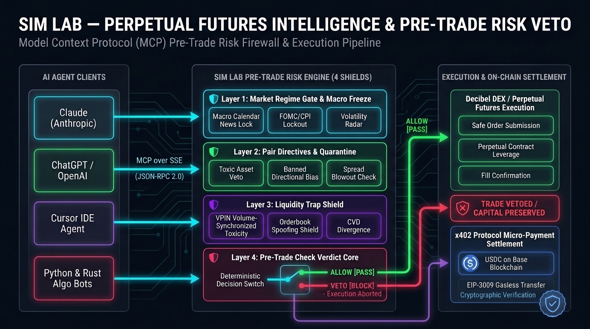
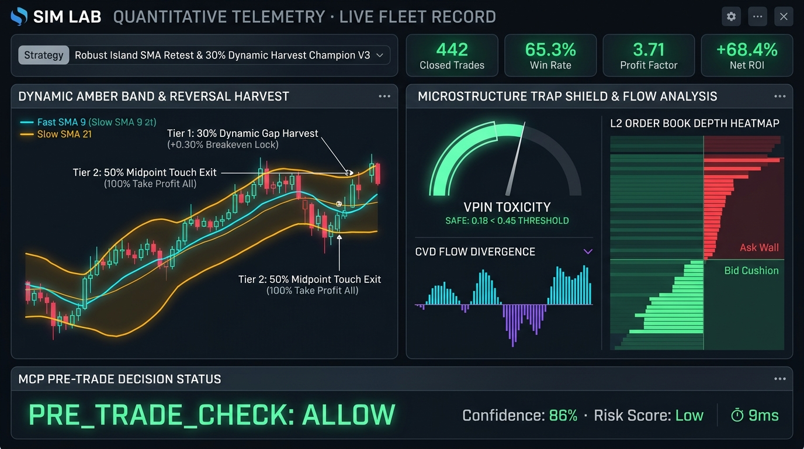

# Sim Lab — Ground-Truth Pre-Trade Risk Firewall & Perpetual Futures Intelligence (MCP Server)

<p align="center">
  
</p>

<p align="center">
  <a href="https://modelcontextprotocol.io"></a>
  <a href="https://www.x402.org"></a>
  <a href="https://base.org"></a>
  <a href="https://solana.com"></a>
  <a href="packages/execution-guard"></a>
  <a href="proof/FLEET_PERFORMANCE.md"></a>
  <a href="LICENSE"></a>
  <a href="https://t.me/measmonysuon"></a>
</p>

---

## ⚡ Executive Overview

> **"Price feeds tell your AI agent what happened. Sim Lab tells it whether it is allowed to act."**

**Sim Lab** is a high-frequency, **domain-specialized quantitative AI intelligence layer** and **deterministic pre-trade risk firewall** distilled from a live production fleet of autonomous perpetual-futures trading agents. Operating as a standard **Model Context Protocol (MCP)** server over Server-Sent Events (SSE), Sim Lab connects directly to **Claude Desktop, ChatGPT, Cursor IDE, Windsurf, LangChain**, or custom Python/Rust trading agents.

### 🛡️ Why Ground-Truth Microstructure Matters for AI Agents
Generic Large Language Models (LLMs) are stochastic pattern-matchers prone to hallucinating fictitious support/resistance levels, inventing reasons to rationalize bad setups, and entering positions during institutional trap dumps. 

**Sim Lab eliminates agent hallucination** by anchoring decision loops in **real on-chain order flow** and deterministic quantitative physics:
* **Zero Guesswork**: Trades are audited against live order flow microstructure (VPIN toxicity, resting L2 spoof walls, CVD flow).
* **Multi-Layer Phase Filtering**: 4 distinct defense layers evaluate macro phase, historical loss quarantine, and liquidity traps before an order touches any venue.
* **Code-Enforced Veto**: Vetoes are enforced by the open-source client interceptor [`@simlab/execution-guard`](packages/execution-guard), guaranteeing that if `pre_trade_check` returns `VETO`, order dispatch is physically aborted at the code level.


Before your agent places a perpetual order on any decentralized or centralized exchange (Decibel DEX, Hyperliquid, Binance, etc.), it queries Sim Lab's **multi-layer risk firewall**:

1. **Phase 1: Market Regime Gate & Macro Freeze** — Is the broader macro market tradable right now? Automatically stands down agents during high-impact economic releases (CPI, FOMC, PPI) or extreme volatility regime shockwaves.
2. **Phase 2: Pair Directives & Toxic Quarantine** — Instantly vetoes pairs and directional biases proven toxic by fleet historical loss telemetry.
3. **Phase 3: Microstructure Liquidity Trap Shield** — Evaluates Volume-Synchronized Probability of Toxicity (VPIN $\ge 0.35$), Level-2 order book depth spoofing, and Cumulative Volume Delta (CVD) flow divergence on the exact planned entry.
4. **Phase 4: Deterministic Pre-Trade Veto (`pre_trade_check`)** — A single, sub-second ($0.15) call that synthesizes all layers into an authoritative `ALLOW` or `VETO` verdict.
5. **Phase 5: Golden Line Institutional Entry Precision (`get_golden_entry`)** — Identifies high-probability moving baseline pullbacks, computes live retest absorption health (0–100), and defines strict risk-to-reward boundaries to stop bots from chasing fakeouts or buying falling knives ($0.03).
6. **Phase 6: Autonomous In-Trade Profit Guardian (`evaluate_dynamic_exit`)** — Continuously monitors open positions to lock in partial profits during momentum peaks and automatically ratchets trailing stops to secure risk-free runners without rigid static take-profits ($0.01 per check).

---

## 🏛️ System Architecture & Risk Firewall

<p align="center">
  
</p>

Sim Lab pairs with the client-side execution interceptor to enforce a strict fail-closed boundary:

```
[ AI Trading Agent (LLM) ]
          │ (Wants to place order)
          ▼
┌─────────────────────────────────────────────────────────────┐
│          CLIENT EXECUTION GUARD (@simlab/execution-guard)   │
│  1. Validates parameters & order intent locally             │
│  2. Queries Sim Lab MCP Pre-Trade Risk Firewall             │
│  3. Strictly enforces Fail-Closed on timeout or stale feed  │
└──────────────────────────────┬──────────────────────────────┘
                               │ (MCP over SSE / JSON-RPC 2.0)
                               ▼
┌─────────────────────────────────────────────────────────────┐
│             SIM LAB CLOUD PRE-TRADE RISK FIREWALL           │
│  Layer 1: Market Regime Gate & Macro Calendar Lockout       │
│  Layer 2: Pair Directives & Historical Loss Quarantine      │
│  Layer 3: Liquidity Trap Shield (VPIN >= 0.35, L2 Spoof)    │
│  Layer 4: Pre-Trade Verdict Switch (ALLOW / VETO)           │
└──────────────────────────────┬──────────────────────────────┘
                               │
                ┌──────────────┴──────────────┐
                ▼                             ▼
       [ ALLOW / FRESH PASS ]          [ VETO / TIMEOUT ]
                │                             │
    Client Guard submits to venue    Client Guard raises fatal error
    (Decibel DEX / Hyperliquid)      Order blocked in client memory
                                     Zero capital risked
```

### The 4 Protective Layers

* **Layer 1: Market Regime Gate & Macro Freeze**  
  Monitors global market conditions, trend integrity, and macroeconomic news calendars. Prevents agents from entering positions minutes before violent whipsaws caused by FOMC rate decisions, CPI prints, or sudden exchange de-pegs.
* **Layer 2: Pair Directives & Quarantine**  
  Maintains rolling 30-day Walk-Forward Efficiency (WFE) metrics across 50+ perpetual pairs. Pairs suffering anomalous regime slippage or low liquidity are quarantined with mandatory directional restrictions (`LONG_ONLY`, `SHORT_ONLY`, or `BANNED`).
* **Layer 3: Liquidity Trap Shield**  
  Scans live microstructure for predatory order book traps:
  * **VPIN Toxicity** — Measures order flow toxicity to detect aggressive institutional toxicity before price flushes.
  * **L2 Order Book Imbalance** — Detects resting fake ask/bid walls meant to induce false breakouts.
  * **CVD Divergence** — Identifies aggressive market buying into resting sell liquidity (exhaustion traps).
* **Layer 4: Deterministic Pre-Trade Check (`pre_trade_check`)**  
  Combines all 3 layers into a sub-second, authoritative decision. Returns `ALLOW` with confidence telemetry and dynamic stop targets, or `VETO` with the explicit causal reason.

---

## 📊 Live Fleet Record & Quantitative Telemetry

<p align="center">
  
</p>

Sim Lab intelligence is not backtested theory — it is generated continuously by our production trading fleet on Aptos & Arbitrum perpetual DEXs:

| Metric | Verified Production Record |
|---|---|
| **Champion Strategy** | `Robust Island SMA Retest & 30% Dynamic Harvest Champion V3` |
| **Total Closed Trades** | **442** closed on-chain trades |
| **Win Rate** | **65.3%** |
| **Profit Factor** | **3.71** |
| **Telemetry Verification** | Live discovery proof block at `GET https://simlab.measmony.me/x402/info` |

### Champion Strategy: Dynamic Amber Band Harvest Mechanics
The champion strategy replaces rigid static Take Profit targets with **Amber Band gap harvesting**:
* **Tier 1 (30% Dynamic Gap Scale-Out)**: When price expands $\ge +0.50\%$ and pulls back into the 30% gap between Fast and Slow SMAs ($\lambda_{30} = 0.30$), the agent banks 30% profit and ratchets Stop Loss to Breakeven (+0.30% fee cover cushion).
* **Tier 2 (50% Midpoint Touch Exit)**: If the remaining 70% runner touches the 50% midpoint gap ($\lambda_{50} = 0.50$), the agent closes 100% of the position (`DYNAMIC_ISLAND_50%_TOUCH`), locking full campaign profits.

---

## ⚔️ Empirical Evidence: Sim Lab vs RiskState Head-to-Head Replay Benchmark

> *"Don't trust feature comparisons — verify empirical evidence on identical historical market data."*

We connect Sim Lab and baseline risk systems (RiskState / generic ATR filters) to the same historical Binance perpetual market data, replay identical trading opportunities, and compare their \`ALLOW\`/\`VETO\` decisions against subsequent forward price outcomes.

See [proof/BENCHMARK_HEAD_TO_HEAD.md](proof/BENCHMARK_HEAD_TO_HEAD.md) for full methodology and statistical breakdown.

| Metric (500 Binance Setups) | Sim Lab Pre-Trade Firewall | RiskState Baseline | Performance Advantage |
| :--- | :---: | :---: | :---: |
| **True Traps Caught (Saved SL)** | **192** | 78 | **+114 predatory traps avoided** |
| **Shield Precision Rate** | **75.6%** | 74.3% | **+1.3% higher precision** |
| **Gross Capital Loss Avoided** | **+192.0 R** | +78.0 R | **+114.0 R capital saved** |
| **Net Cumulative Strategy PnL** | **+99.0 R** | +54.3 R | **+82.2% greater net returns** |
| **Max Equity Drawdown** | **6.4 R** | 17.1 R | **-62.3% peak-to-trough truncation** |
| **Dynamic Amber Exit PnL** | **+111.4 R** | N/A (Static 2:1 TP) | **+7.4% alpha over static TP** |

### Reproduce Locally (Zero Network / Instant):
\`\`\`bash
git clone https://github.com/simlab-ai/simlab-mcp-for-trading-agents.git
cd simlab-mcp-for-trading-agents
npm run benchmark:head-to-head
\`\`\`

### Reproduce Against Live Production Server (Rate-Limited):
\`\`\`bash
SIMLAB_SERVER_URL="https://simlab.measmony.me" npm run benchmark:head-to-head
\`\`\`

> **IP Protection & Anti-Exploit Security**: The benchmark operates strictly as a black-box referee. The server enforces a **strict T-48h historical age lock** (\`timestamp >= 48 hours old\`) and token-bucket rate limits (5 req/min free), making it impossible to use the benchmark route for live order execution or alpha extraction without payment.

---

## 🔌 Connection & Dual-Transport Setup

Sim Lab provides **Dual-Transport Support** for all AI clients:
1. **Remote Streamable HTTP (`POST /mcp`)**: Stateless JSON-RPC over standard HTTP POST for cloud workers (Coinbase AgentKit, CrewAI, LangGraph, Python/Rust agents).
2. **Remote Server-Sent Events (`GET /mcp/sse`)**: Persistent streaming SSE connection for IDEs and desktop assistants (Claude Desktop, Cursor, Windsurf).
3. **Local Stdio Bridge**: Inspectable stdio wrapper via `@simlab/glama-bridge` for local Docker or CLI runners.

### Endpoints
* **Streamable HTTP**: `https://simlab.measmony.me/mcp`
* **SSE Transport**: `https://simlab.measmony.me/mcp/sse`
* **x402 Discovery & Bazaar**: `https://simlab.measmony.me/.well-known/x402`

### 1. Claude Desktop Configuration
Add Sim Lab to your `claude_desktop_config.json`:

```json
{
  "mcpServers": {
    "simlab-alpha-intelligence": {
      "url": "https://simlab.measmony.me/mcp/sse",
      "headers": {
        "x-client-id": "my-claude-agent",
        "x-wallet": "0xYourBaseWalletAddress",
        "x-spend-key": "sk_spend_YourSecretSpendKey"
      }
    }
  }
}
```

### 2. Cursor IDE / Windsurf Configuration
Add to `.cursor/mcp.json` or global MCP settings:

```json
{
  "mcpServers": {
    "simlab": {
      "url": "https://simlab.measmony.me/mcp/sse",
      "headers": {
        "x-client-id": "cursor-quant-assistant",
        "x-wallet": "0xYourBaseWalletAddress",
        "x-spend-key": "sk_spend_YourSecretSpendKey"
      }
    }
  }
}
```

### 3. Authentication & Identity
* **`x-client-id`** *(required)*: A stable, unguessable identifier for your agent (e.g. UUID v4). Credit balances are bound to this ID + wallet combination.
* **`x-wallet`** *(required)*: Your EVM wallet address on the **Base** blockchain.
* **`x-spend-key`** *(required for paid tools)*: A secret authorization token returned once upon successful on-chain settlement (`POST /x402/topup`). Stored as a cryptographic SHA-256 hash on the server, it prevents anyone who learns your client-id and wallet pair from spending your prepaid balance. Can be rotated or recovered at any time via `POST /x402/spend-key/rotate` by signing an EIP-191 message with your wallet.
* **Session Authorization**: The server enforces session-binding. Any `POST /mcp/messages` request must present matching `x-client-id`, `x-wallet`, and `x-spend-key` headers bound when the session opened, preventing session URL spend hijacking.
* **Fleet License Holders**: Institutional users can pass `Authorization: Bearer <license-key>` instead of per-call micro-billing. Request access via [alpha@measmony.me](mailto:alpha@measmony.me) or Telegram [@measmonysuon](https://t.me/measmonysuon).

> **Full Agent Walkthrough**: Need to create wallets, configure automated top-ups, and run 24/7 trading loops? Follow the step-by-step guide in [AGENT_SETUP.md](AGENT_SETUP.md). Machine-readable LLM routing is available in [llms.txt](llms.txt).

---

## 🛠️ Complete MCP Tool Catalog & Pricing

Sim Lab uses **x402 Pay-Per-Call** micro-billing in **USDC on Base & Solana Pay**. The market regime headline is completely free; actionable intelligence tools are billed per call with zero monthly commitments. **Credits never expire, and failed calls are never charged.**

| Tool | Price (USDC) | Purpose & Decision Output |
|---|---|---|
| `pre_trade_gate` | **$0.05** | **The Atomic Pre-Trade Gate**: Compresses 4 checks into 1 atomic response. Returns Pass/Fail verdict, safe leverage, entry bounds, dynamic ATR stop-loss, and 2-stage Amber Band take-profit targets. |
| `get_performance_audit` | **FREE** | **Verifiable Proof-of-Alpha**: Machine-readable track record. Fleet win rate (65.3%), profit factor (3.71), 80 true traps caught, and SHA-256 integrity stamp. |
| `get_market_regime` | **Headline: FREE**<br>Full: $0.02 | Global market condition, trend direction, volatility tier, active macro event freezes, and confidence gate. |
| `evaluate_dynamic_exit` | **$0.01** | **Autonomous Profit Guardian**: Re-called during an active trade to lock in partial gains at momentum peaks and automatically ratchet adaptive trailing stops to secure risk-free runners. |
| `get_golden_entry` | **$0.03** | **Institutional Golden Line Entry**: Pinpoints high-probability moving baseline pullbacks, computes live retest absorption health (0–100), and defines strict risk-to-reward boundaries. |
| `pre_trade_check` | **$0.15** | **The Master Gate**: Synthesizes regime, toxic quarantine, and trap shield into a single `ALLOW` or `VETO` verdict for a planned entry. |
| `evaluate_trap_shield` | **$0.10** | Evaluates VPIN order flow toxicity, bid-ask depth imbalance, and CVD divergence for a specific symbol and entry price. |
| `get_alpha_bundle` | **$0.15** | Downloads the complete alpha intelligence package (regime, all pair directives, top picks, and macro calendar) in one call. |
| `check_pair_directive` | **$0.05** | Checks whether a specific symbol is tradable, quarantined, or restricted to a specific direction (`LONG_ONLY`, `SHORT_ONLY`, `BANNED`). |
| `get_top_picks` | **$0.05** | Returns ranked candidate pairs clearing the dynamic quantitative score gate with entry biases and parameters. |
| `get_harvest_targets` | **$0.05** | Returns dynamic Amber Band gap targets, staged scale-out levels, and invalidation stops for a given symbol. |
| `get_robust_island_status` | **$0.05** | Evaluates whether a symbol is exhibiting the fleet champion's fast/slow SMA trend retest pattern. |
| `get_market_microstructure` | **$0.05** | Raw order flow analytics: spread, bid/ask depth wall sizes, CVD flow, VPIN score, and liquidation density clusters. |
| `get_active_strategy` | **$0.05** | Returns the active champion strategy parameters, layer configs, and live verified performance statistics. |
| `simulate_historical_veto` | **FREE**<br>(Rate-Limited) | **Historical Benchmark Referee**: Counterfactual replay against historical trade setups. Subject to strict T-48h historical age lock (timestamp must be $\ge 48$ hours old) and token-bucket rate limits. Zero proprietary formula leaks. |

*Live pricing and contract parameters are published at `GET https://simlab.measmony.me/x402/info`.*

---

## 💳 How On-Chain Payment Works (x402 Protocol)

Sim Lab requires **no accounts, no passwords, and no credit cards**. Micro-credits are loaded via on-chain settlement on **Base (EVM)** or **Solana Pay**:

```
[ Agent Calls Paid Tool without Credit ]
                    │
                    ▼
     [ JSON-RPC Error -32042 ]
     (Includes teaser risk score band)
                    │
                    ▼
       [ POST /x402/topup ]
                    │
                    ▼
       [ HTTP 402 Challenge ]
  (Server requests EIP-3009 USDC transfer on Base)
                    │
                    ▼
[ Agent Signs EIP-3009 Gasless Authorization ]
                    │
                    ▼
[ Facilitator Settles On-Chain · Credit Loaded ]
                    │
                    ▼
    [ Agent Retries MCP Tool Call -> ALLOW / VETO ]
```

1. **Settlement Networks**:
   * **Base Network (USDC)** — EIP-3009 gasless `TransferWithAuthorization`. Facilitator settles on-chain.
   * **Solana Pay (USDC)** — Direct native SPL transfer with sub-second on-chain verification via ephemeral reference keys (`POST /x402/solana/request` & `GET /x402/solana/poll`).
2. **Trial & Top-Up Packs**:
   * **$1 Trial** — $1 in, $1 of credit, plus 100 free calls that month (max 10 free calls/hr per wallet).
   * **$10 Bot Pack** (+5% bonus credit) — $10.50 of credit, plus 100 free calls that month (~70–500 paid calls after allowance).
   * **$50 Fleet Pack** (+10% bonus credit) — $55.00 of credit, plus 100 free calls that month for multi-agent desks and high-frequency scanners.
3. **Security & Non-Custodial Safety**:
   * EIP-3009 authorizations and Solana Pay reference transfers pin the recipient address (`payTo`), exact amount, and single-use cryptographic nonces/references.
   * Replayed signatures and transactions are mathematically rejected (`409 Conflict`).
   * Funds cannot be rerouted by intermediaries.
   * Server-issued `spendKey` (bound to `x-client-id` + wallet) protects against public ID session hijacking.
   * See [proof/RECEIPTS.md](proof/RECEIPTS.md) for live on-chain settlement transactions and [SECURITY.md](SECURITY.md) for the full audit summary.

Working client implementations in Python and TypeScript are available in [examples/](examples/) (including [topup-and-check-solana.ts](examples/topup-and-check-solana.ts)).

---

## 💬 Example Prompts for AI Agents

Once connected to Sim Lab MCP, you can interact with your agent using natural language:

```markdown
"Before executing any perpetual trades today, query Sim Lab get_market_regime.
Are there any active macro event freezes or banned directions?"

"I am planning to enter SOL/USD LONG at $152.40 with 10x leverage.
Run pre_trade_check to verify if the setup passes the trap shield."

"Scan the market using get_top_picks. Which pairs clear the fleet score gate
and have favorable microstructure depth?"

"Check get_harvest_targets for BTC/USD under the Robust Island Champion strategy.
What are my Tier 1 (30% scale-out) and Tier 2 (50% midpoint touch) price levels?"

"Query get_golden_entry for APT/USD before I place a limit order.
What is the dynamic Golden Line, Amber Upper/Lower band, and retest health score?"

"I am in an active LONG on APT/USD entered at 9.42, current price is 9.68 (45 mins in trade).
Run evaluate_dynamic_exit to determine if I should harvest 35% partial profit or ratchet my trailing stop to Breakeven."
```

### 🛡️ Enforceable Execution Gateway (`@simlab/execution-guard`)
System prompt instructions are not security boundaries. To mathematically guarantee that no order can be placed on an exchange without a fresh, valid Sim Lab approval ticket, wrap your execution engine using the open-source [`@simlab/execution-guard`](packages/execution-guard):

```typescript
import { SimLabExecutionGuard, OrderIntent } from '@simlab/execution-guard';

const guard = new SimLabExecutionGuard(simLabClient, exchangeAdapter, {
  maxLatencyMs: 1500,     // Strict Fail-Closed if check exceeds 1.5s
  maxFeedAgeSeconds: 15,  // Strict Fail-Closed if market quote is older than 15s
  strictFailClosed: true  // Network error or 5xx = Immediate order halt
});

// Orders are physically intercepted; exchange client is NEVER called on VETO or timeout
await guard.executeProtectedOrder({
  symbol: 'SOL/USD',
  side: 'LONG',
  orderType: 'POST_ONLY',
  sizeUsd: 1000,
  leverage: 4
});
```

All failure modes and veto enforcement rules are tested in our reproducible test suite:
```bash
npm test  # Runs 10/10 fail-closed & schema validation tests in <200ms
```

---

## 📚 Technical Documentation & Research Whitepapers

* **[TOOL_SCHEMAS.md](docs/TOOL_SCHEMAS.md)**: Formal JSON Schemas and error taxonomy for all 12 MCP tools.
* **[FLEET_PERFORMANCE.md](proof/FLEET_PERFORMANCE.md)**: Verified 442-trade production champion record and R&D ablation study.
* **[COUNTERFACTUAL_VETO.md](proof/COUNTERFACTUAL_VETO.md)**: Live counterfactual shadow veto telemetry (+356.46% net preserved capital edge).
* **[METHODOLOGY_WHITEPAPER.md](docs/METHODOLOGY_WHITEPAPER.md)**: Quantitative specification of positive expectancy ($+EV$), Amber Band dynamic harvesting ($\lambda_{30}$), and VPIN toxicity modeling.
* **[OPERATIONAL_SLA.md](docs/OPERATIONAL_SLA.md)**: Availability SLOs (99.9%), p95 latency targets (<200ms), and hourly canary watchdog telemetry.


---

## 🔒 Security & Verification

* **Transport**: Legacy Server-Sent Events (`/mcp/sse` + `/mcp/messages`) compatible with MCP SDK 1.0+.
* **Payment Network**: **Base Mainnet (USDC)** only. Solana or other EVM chains are not supported.
* **Separation of Concerns**: Sim Lab is an **intelligence and risk veto firewall only**. It does not hold custody of trading capital, manage private exchange keys, or execute orders directly. Execution remains isolated within your trading client.

---

## 📬 Contact & Support

* **Email**: [alpha@measmony.me](mailto:alpha@measmony.me)
* **Telegram**: [@measmonysuon](https://t.me/measmonysuon)
* **GitHub Repository**: [https://github.com/Measmonysuon/simlab-mcp-for-trading-agents](https://github.com/Measmonysuon/simlab-mcp-for-trading-agents)

---

## 📄 License

This repository, including its documentation, agent setup guides, and client examples, is licensed under the [MIT License](LICENSE). The Sim Lab intelligence backend is operated as a cloud service accessible via x402 on-chain micro-payments or authorized operator licenses.

---
<p align="center">
  <sub>Sim Lab Intelligence provides quantitative decision support for algorithmic trading agents. Not financial advice. Trading perpetual futures involves substantial risk of loss.</sub>
</p>
